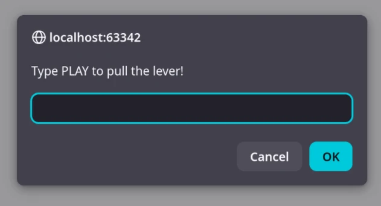
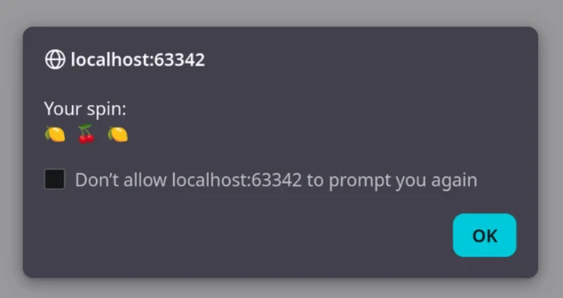
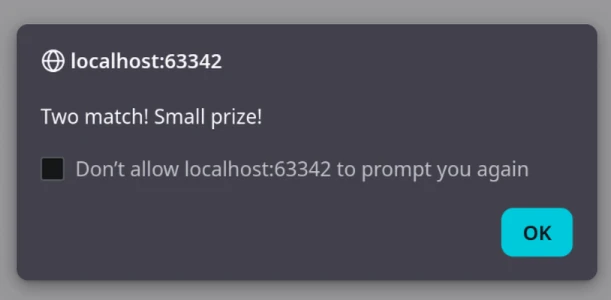
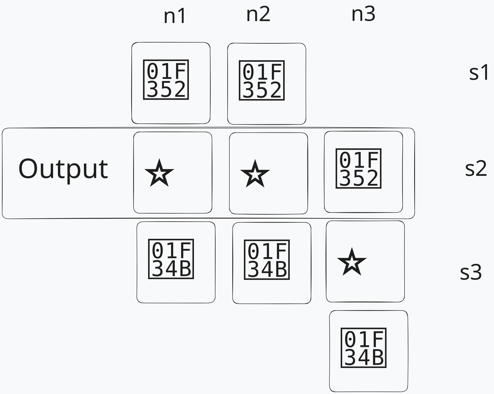

# LU01 Demo

This is an extra example of putting everything we learned in this unit together.

1. The user must enter "Play" to start. We validate user input, input is not case-sensitive and trims spaces.
   
2. The game outputs the random output
   
3. The game outputs the winning amount.
   

## Logic

The game must generate three random numbers between 1 and 3.
Then with each random number we must output a symbol.

| Number | Symbol | 
|--------|--------|
| 1      | 🍒     |
| 2      | ⭐      |
| 3      | 🍋     |

