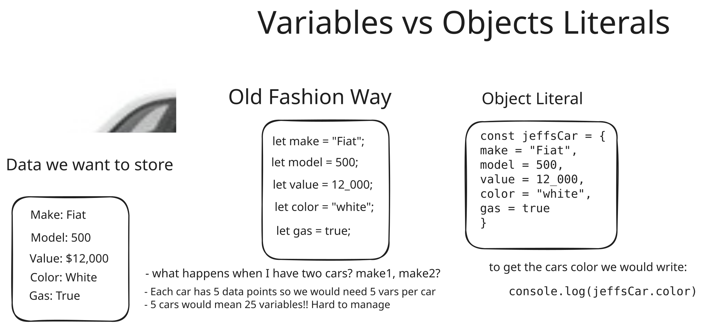

# Object Literals

## Primitives Review

[Mozilla Docs](https://developer.mozilla.org/en-US/docs/Glossary/Primitive) on Primitives.

- Primitive data types in JavaScript include:

    - Numbers: Integers, floats
    - Strings: Any data under a single quote, double quote or backtick quote
    - Booleans: true or false value
    - Null: empty value or no value
    - Undefined: A declared variable without a value

## JS Objects

[//]: # (TODO replace this video with a better one)

- [W3 Docs on Objects](https://www.w3schools.com/js/js_objects.asp)
- [Good Video Explanation](https://www.youtube.com/watch?v=QB_oKKb4L3c)

Objects in JS are much more flexible and different than Java or C#.
While we can do the things the same way with `class` we will not be doing that in this unit.

> [Link to digram file](assets/objects.excalidraw)

- Look at [`literals.html`](literals.html)

## Can't compare non-primitives

- Non-primitive data types in JavaScript include:
    - Objects
    - Arrays
- non-primitive data types are not comparable, even two non-primitive data types that have the same values are not
  strictly equal
- Look at [`cantCompare.html`](cantCompare.html)
