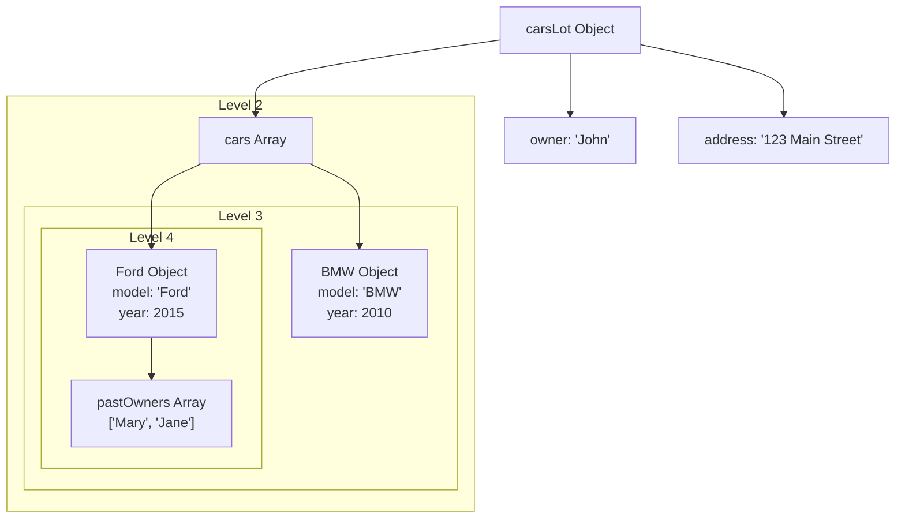

# Nested Objects

- [Video Exampling](https://www.youtube.com/watch?v=b8gwYQ_V4K4)
- [Code Example](https://www.w3schools.com/js/tryit.asp?filename=tryjs_array_nested)

## Diagram

Code

```js
const carsLot = {
    owner: "John",
    address: "123 Main Street",
    cars: [
        {
            model: "BMW",
            year: 2010
        },
        {
            model: "Ford",
            year: 2015,
            pastOwners: ["Mary", "Jane"]
        }
    ]
}
```

Diagram



## Example

[`index.html](index.html)