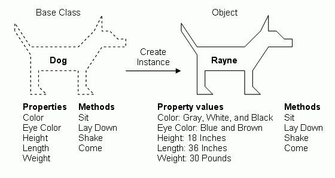

# OOP in JavaScript

## Made by: Luke Matheis

---

# What is OOP?

Object-Oriented Programming is a programming paradigm based on the concept of **"objects"**.
Objects can contain data (in the form of properties) and code (in the form of methods).

* **Modeling:** It helps us model real-world things (like a car, a user, or a task) inside our code.
* **Organization:** It focuses on grouping related data and behavior together.
* **The core ideas:** Encapsulation, Inheritance, and Polymorphism.
    - We will **not** cover Inheritance and Polymorphism in this course.

---



---

# What Exactly is a Class?

## A **Class** is a **blueprint** or a **template**.

It defines the structure and behavior of objects, but it is not an object itself.

- It's like the architectural drawing for a house.
- A Class defines what properties an object *will have* (e.g., color, size) and what methods it *can perform* (e.g.,
  open door).

---

# History: JS and Classes

## The Pre-ES6 Era (2015)

* **No Classes:** Before 2015, JavaScript did not have a `class` keyword.
* **Prototypes:** Developers used **constructor functions** and the complex **prototype chain** to mimic OOP behavior.

```javascript
// Before Classes (ES5 Style)
function Person(name) {
    this.name = name;
}

Person.prototype.greet = function () {
    console.log(`Hello, ${this.name}`);
};
```

> We will never do this!

---

# The Modern Era: ES6+

Introducing the `class` Keyword

* The `class` keyword is mostly **syntactic sugar**.
    * It does **not** replace the prototype chain; it just provides a much clearer, cleaner syntax on top of it.
* It makes JS look and feel more like other OOP languages (Java, Python, C#).

```javascript
class Person {
    constructor(name) {
        this.name = name;
    }

    greet() {
        console.log(`Hello, ${this.name}`);
    }
}
```

---

# Class vs. Object (Instance)

| Feature      | Class (Blueprint)                       | Object /Instance (Product)                  |
|--------------|-----------------------------------------|---------------------------------------------|
| **Example**  | `class Car { ... }`                     | `const myCar = new Car(...)`                |
| **Nature**   | The template, the abstract concept.     | The specific, concrete entity in memory.    |
| **Creation** | Defined once using the `class` keyword. | Created many times using the `new` keyword. |
| **Memory**   | Takes up very little memory.            | Each one takes up separate memory.          |

