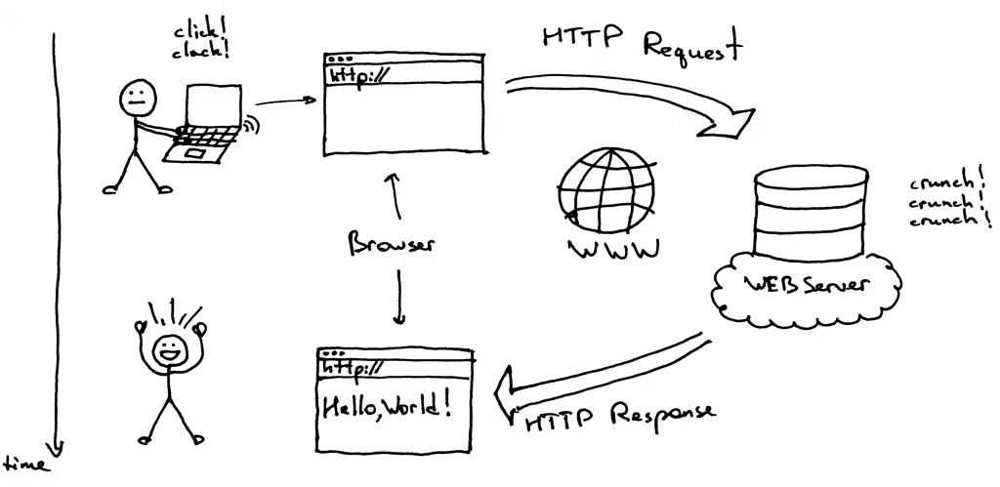
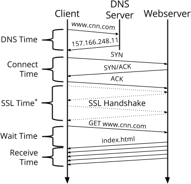

# APIs
## How computers talk to each other

By: Luke Matheis

---

# What is an API?

* **API** stands for **Application Programming Interface**.
* It is the bridge that allows two pieces of software to talk to each other.
* **ANY** two programs can talk to each other
  - They don't need to be written by the same company.
  - Don't need to be in the same programming language.
  - Don't need to be on the same computer.

---

# Client vs. Server



---

# How HTTP Works

**HyperText Transfer Protocol** (HTTP)
Every request has two main parts:

1. **The URL (Endpoint):** `https://api.example.com/users`
2. **The Verb (Method):** Tells the server *what* to do.

### The Common Verbs:

* **GET**: "Read" (Fetch data)
* **POST**: "Create" (Send new data)
* **PUT/PATCH**: "Update" (Edit existing data)
* **DELETE**: "Remove" (Delete data)

---

# Status Codes (The Server's Answer)

How do we know if the request worked? The server sends a 3-digit code.

* **200 OK:** Success! Everything went fine.
* **201 Created:** Success! New data was saved.
* **400 Bad Request:** You sent something wrong.
* **404 Not Found:** That URL doesn't exist.
* **500 Server Error:** The server crashed.

---

# JSON:

APIs don't usually send back HTML; they send **JSON**. Some sites send XML but most are JSON.

```json
{
  "id": 101,
  "user": "JS_Coder",
  "status": "Learning APIs",
  "isOnline": true
}

```

---

# Fetch

JavaScript has a built-in tool to make HTTP requests.
HTTP requests take time, so we have to do things asynchronously.



```javascript
fetch('https://api.example.com/users')
  .then(response => response.json())
  .then(data => console.log(data));
```

---

# Two Ways JS Uses APIs

JavaScript is unique because it can be on **both ends** of the API.
In this class we only do **Client-Side JS**.

1. **Client-Side JS (The Consumer):**
* Your code runs in the browser.
* Example: Fetching weather data to show on a website.


2. **Server-Side JS (The Provider):**
* Your code runs on a server (Node.js).
* Example: You write the code that waits for a request and sends back data from a database.


---

# Summary

* **API:** The bridge between apps.
* **HTTP:** The protocol (GET, POST, 200, 404).
* **JSON:** The data format.
* **`fetch`:** The JS tool to make requests.
* **Client vs Server:** JS can ask for data or be the one giving it!

