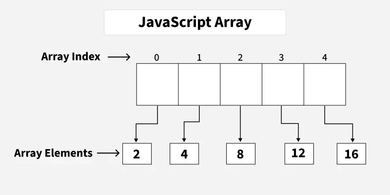

# Arrays

[Arrays W3Schools](https://www.w3schools.com/js/js_arrays.asp)

* Today we will start to learn to use arrays. Arrays are a data structure to store multiple values
  each value has an index. Index starts at 0.
  Arrays in JS can have many different data types in the same arrays
* Define arrays there are two ways
  - Array Constructor or using []
  - go to `arraysIntro.html`
* Now let's split strings into arrays `usingSplit.html`
* Now let's move on to modifying arrays and manipulate them `arrayPlayGround.html`
